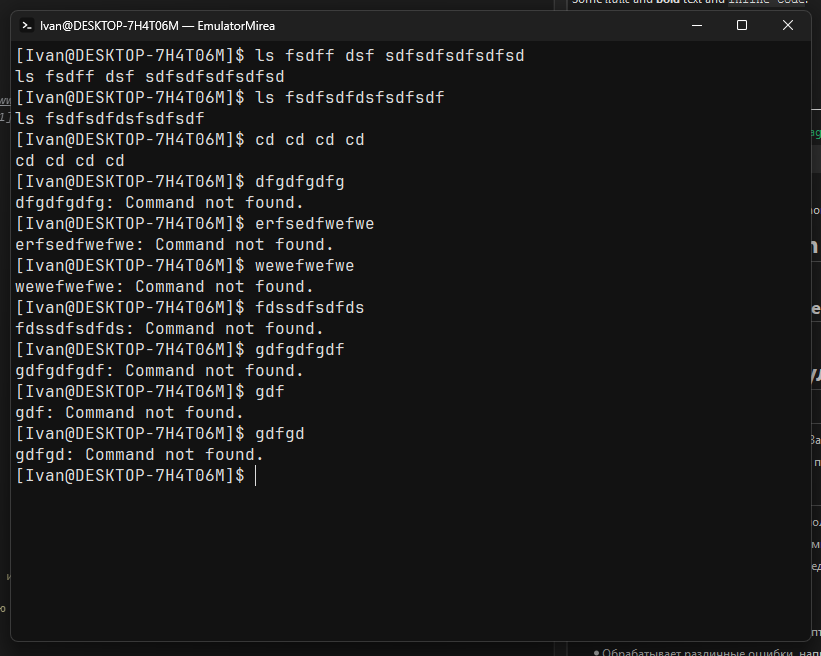

# Emulator Mirea - эмулятор для языка оболочки ОС (вариант 5)
## Описание
Это простой GUI эмулятор оболочки ОС с Bash подобным языком.   
Написан используя фреймворк Qt 6 и язык программирования C++ с использованием CMake как систему сборки 
## Текущий функционал
- Имеет 2 команды заглушки ls и cd и полноценно функционирующую команду exit для выхода
- Берет реально имя пользователя и компьютера
- Обладает доступом к переменным среды ОС
- Поддерживает 2 аргумента
    - --vfs - расположение VFS
    - --script - путь к стартовому скрипту
- Обрабатывает различные ошибки, например ошибку неизвестной команды и неверные аргументы команды exit

## Сборка и запуск
**Требования:** компилятор с C++23 (GCC 13+, Clang 17+, MSVC 2022), CMake 3.20+, Qt 6.12 (Core, Widgets), Ninja (рекомендуется). Если в репозитории дистрибутива Qt старше 6.12, установите его через [Qt Online Installer](https://www.qt.io/download-qt-installer-oss) и выберите комплект под свой компилятор.
 
**Командная строка.** Путь к Qt задаётся через `CMAKE_PREFIX_PATH` (каталог комплекта, не `bin`):
 
```bash
cmake -S . -B build -G Ninja -DCMAKE_BUILD_TYPE=Release -DCMAKE_PREFIX_PATH=~/Qt/6.12.0/gcc_64
cmake --build build
./build/EmulatorMirea
```
 
Windows (из «x64 Native Tools Command Prompt for VS 2022»):
 
```bat
cmake -S . -B build -G Ninja -DCMAKE_BUILD_TYPE=Release -DCMAKE_PREFIX_PATH=C:\Qt\6.12.0\msvc2022_64
cmake --build build
build\EmulatorMirea.exe
```
 
Если при запуске из `build` не находятся `Qt6*.dll`, добавьте `<комплект>\bin` в `PATH` или используйте установку (ниже). На macOS запускайте `build/EmulatorMirea.app`.
 
**Qt Creator.** `File → Open File or Project…` → `CMakeLists.txt` → выбрать комплект (Kit) с Qt 6.12 → `Ctrl+R`. Prefix подставится автоматически.
 
**Установка** (на Windows и macOS запускает `windeployqt` / `macdeployqt`, на Linux развёртывание не выполняется):
 
```bash
cmake --install build --prefix dist
```
 
Для Visual Studio добавьте `--config Release`. Проверяйте `dist/bin/EmulatorMirea` в окружении без Qt в `PATH`.
 
**Частые ошибки:**
 
- `Could not find a package configuration file provided by "Qt6"`: неверный `CMAKE_PREFIX_PATH`; после исправления удалите каталог `build`.
- Подхватился системный Qt другой версии: укажите путь явно.
- Комплект Qt (MSVC / MinGW / gcc) должен совпадать с компилятором проекта.

## Примеры использования


